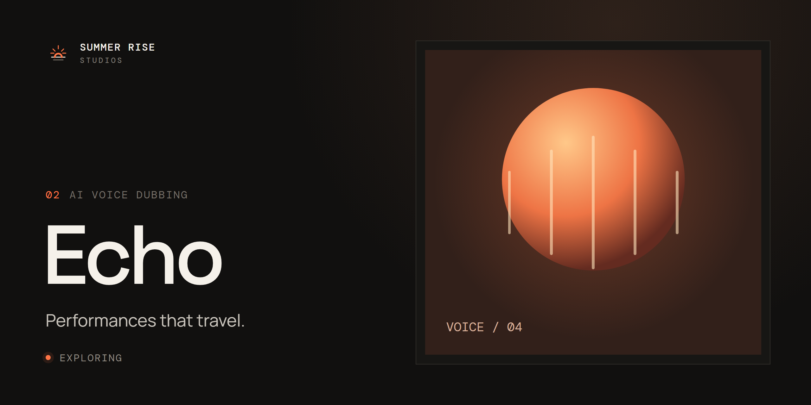

<p>
  <a href="LICENSE"></a>
  <a href="https://github.com/summerrise-studios/echo/actions/workflows/tests.yml"></a>
  
  <a href="https://www.summerrise.studio"></a>
</p>

# Echo

**Performances that travel.**

Echo is exploring expressive voice dubbing that lets a character stay themselves as a story moves between languages.

## What we're working on

A good dub keeps the performance, not just the words:

- **Identity:** a character should still sound like themselves in another language.
- **Expression:** the emotion, emphasis, and timing of the original performance should carry over.

## The prototype

`echo-dub` takes a video (or audio) in Telugu and gives it back in English,
spoken in each character's own voice, timed to their lines, over the original
music and effects.

```
source ─ Demucs ─► voice stem + music/effects stem
voice stem ─ find lines ─ BuzzASR (Telugu speech recognition) ─ group by voice ─► segments.json
segments ─ language model: translate each line to fit its time, label its emotion ─► segments.json
segments ─ Chatterbox: clone each speaker from their own lines, speak with that emotion ─► lines
lines ─ fit to the slot (re-write if far too long, then speed up at most 1.3×) ─ match each line's loudness
      ─ mix over music/effects ─► dub.mp4, dub.en.srt, report.html
```

The language model writes and Echo measures. Every line gets a syllable budget
from how long the actor speaks; lines that would run long go back to the model
with their counts, and after the voice is generated Echo measures how fast it
actually speaks and asks for shorter wording where a line still overruns. Each
line's loudness is matched to the original, so a shout stays a shout and a
whisper stays a whisper.

Every stage writes its result to the output folder. Open `report.html` to
review the dub line by line, fix any line in `segments.json`, and run again
with `--resume` to re-voice just your edits.

### Try it

Needs Python 3.10 or newer, [FFmpeg](https://ffmpeg.org), and an NVIDIA GPU
with 6 GB or more (it runs on CPU too, slowly). The models download on first
use (about 6 GB).

```bash
git clone https://github.com/summerrise-studios/echo.git
cd echo
pip install torch==2.6.0 torchaudio==2.6.0 --index-url https://download.pytorch.org/whl/cu124
pip install -e ".[speech,claude]"
echo-dub scene.mp4 --consent
```

`--consent` confirms that you may clone every voice in the file (see below).
Useful options:

| Option | What it does |
|---|---|
| `--transcript lines.srt` | use your own transcript instead of speech recognition |
| `--speakers 2` | the number of speakers, if you know it |
| `--no-separate` | the file is clean speech with no music: skip separation |
| `--from hi` | another spoken language (Whisper large-v3 turbo is used outside Telugu) |
| `--llm gemini` | translate with Gemini (set `GEMINI_API_KEY`) |
| `--llm ollama` | translate with a local model instead of Claude |
| `--resume` | reuse finished stages and re-voice an edited `segments.json` |

### Which models it uses

| Step | Model | License |
|---|---|---|
| Music and effects apart from the voice | [Demucs](https://github.com/facebookresearch/demucs) htdemucs | MIT |
| Telugu speech recognition | [BuzzASR/telugu](https://huggingface.co/BuzzASR/telugu), a Whisper large-v3 fine-tune | MIT |
| Telling voices apart, cloning them | [Chatterbox](https://github.com/resemble-ai/chatterbox) by Resemble AI | MIT |
| Translation and emotion | Claude Opus 5.5 (default when configured), Gemini (`--llm gemini` with `GEMINI_API_KEY`), or a local model through [Ollama](https://ollama.com) | |

Only one model holds the GPU at a time, so the whole dub runs on a 6 GB laptop
GPU. We chose Chatterbox over XTTS-v2, F5-TTS and Fish Speech because its
license allows commercial use and it has a direct control for emotional
intensity.

### Consent and watermarking

Echo copies voices. Only dub voices you have the right to use: your own, or
people who agreed to have their voice cloned for this. `echo-dub` will not run
without `--consent`. Every line it speaks carries Resemble AI's imperceptible
Perth watermark, which marks the audio as AI-generated; Echo keeps it.

### Limits

- English is the only dub language today. Chatterbox speaks 23 languages, but
  Telugu is not one of them yet.
- The voice is cloned from the speaker's own lines in the file, so a speaker
  with only a second or two of clean speech clones poorly.
- Emotion is read from the words, the context and how loud and fast the line
  is, not from the full sound of the performance. Laughs, cries and breaths
  are not carried over yet.
- Lips are not re-synced; the dub fits each line's timing, not the mouth.
- Translation quality depends on the language model. Small local models know
  little Telugu; use Claude or Gemini for dubs you mean to keep, and have a fluent
  speaker review `report.html`.

## Status

**v1 prototype.** The full pipeline runs end to end on a laptop GPU: a
27 second, two-speaker Telugu clip over music dubs in about two and a half
minutes on an RTX 3050 with 6 GB, both voices told apart and kept. The timing,
mixing, translation loop and subtitles are unit tested. Watch this
repository, or [join the list](https://www.summerrise.studio/#contact) to hear
when there's a demo, a release, or a research note.

## Contributing

Ideas, feedback, and research pointers are welcome: [open an issue](https://github.com/summerrise-studios/echo/issues/new/choose). Please read the [contributing guide](https://github.com/summerrise-studios/.github/blob/main/CONTRIBUTING.md) and [code of conduct](https://github.com/summerrise-studios/.github/blob/main/CODE_OF_CONDUCT.md) first. To report a security problem, follow the [security policy](https://github.com/summerrise-studios/.github/blob/main/SECURITY.md).

## License

Echo is open source under the [GNU Affero General Public License v3.0](LICENSE).
You can use, study, change, and share it. If you run a modified version as a
network service, you must offer its users the source code of your changes.

For hosted plans, support, or commercial licensing, contact
[jampanikomal@summerrise.studio](mailto:jampanikomal@summerrise.studio).

---

Built by [Summer Rise Studios](https://www.summerrise.studio) · [LinkedIn](https://www.linkedin.com/company/summerrise-studios) · [X](https://x.com/SummerRiseStudi) · [Instagram](https://www.instagram.com/summerrisestudios/)
